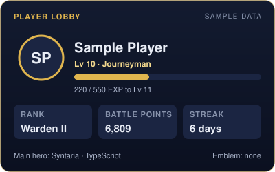
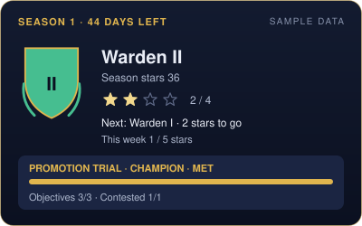
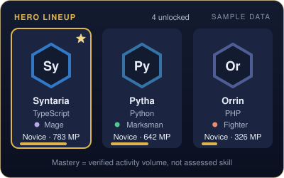
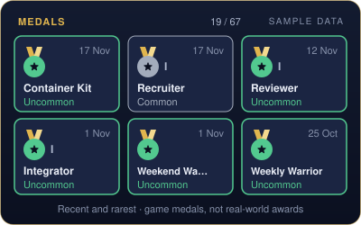
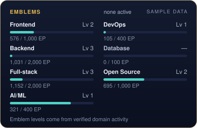
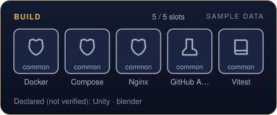

# Hey, I'm Hadrian Rangga Ardiantara 👋

### Software Developer · Backend Engineer · AI/ML Enthusiast

I'm a software development student from Bandung, Indonesia, who enjoys building real-world applications, exploring new technologies, and turning ideas into working software.

I mainly work on web development, backend systems, mobile applications, and deployment, while continuously exploring artificial intelligence, machine learning, game development, and interactive technologies.

- 🔭 Currently building web applications, backend systems, and mobile applications
- 🌱 Exploring backend engineering, AI/ML, DevOps, and system architecture
- 🥈 2nd Place — SATUCREANOVA 2026, Web Development — **Nawasena**
- 🥉 3rd Place — TECHNOVA 2026
- 🥉 3rd Place — INOVENTURE 2025
- 🚀 Interested in building software that solves real-world problems
- 🎮 Also interested in games, anime, and creative technology
- 💻 Motto: *Learn hard now, relax later.*

<!-- LEGENDS:START -->
<!-- Generated by GitHub Legends from legends/templates/readme-block.md. Do not edit inside the LEGENDS markers: changes are overwritten on the next run. Edit the template instead. -->

### ⚔️ GitHub Legends

> **Sample data.** This block was generated from fixtures. It is not a real player's progress.

  <picture><source media="(prefers-color-scheme: dark)" srcset="assets/legends/dark/player-card.svg"><source media="(prefers-color-scheme: light)" srcset="assets/legends/light/player-card.svg"></picture>
  <picture><source media="(prefers-color-scheme: dark)" srcset="assets/legends/dark/season-card.svg"><source media="(prefers-color-scheme: light)" srcset="assets/legends/light/season-card.svg"></picture>

<!-- legends:section:lobby -->

<!-- legends:section:statistics -->
**Level 10 · Warden II · Season 1 (44 days left) · 6,809 BP**

<b>📊 Player statistics</b>: 205 commits · 16 merged PRs · 11 reviews

| Statistic | Value | Source |
| --- | --- | --- |
| Qualifying commits | 205 | ✔ verified |
| Merged pull requests | 16 | ✔ verified |
| Peer reviews | 11 | ✔ verified |
| Issues opened / resolved | 0 / 4 | ✔ verified |
| Releases | 2 | ✔ verified |
| Battles (victories, MVP) | 41 (41, 8) | Σ derived |
| Quests completed | 94 | Σ derived |
| Campaigns completed | 2 | Σ derived |
| Medals | 19 / 67 | Σ derived |

<!-- legends:section:level -->
✨ **Level 10 · Journeyman** — ▰▰▰▰▱▱▱▱▱▱ 40% · 220 / 550 EXP · 330 EXP to level 11

<!-- legends:section:rank -->
🛡 **Warden II** — 2 ★ to Warden I · 1/5 ★ this week · Champion trial: objectives 3/3, contested 1/1 (met)

<!-- legends:section:season -->
🗓 **Season 1** · 1 Oct – 31 Dec 2026 · 44 days left · 41 battles, 41 victories, 8 MVP

  <picture><source media="(prefers-color-scheme: dark)" srcset="assets/legends/dark/hero-lineup.svg"><source media="(prefers-color-scheme: light)" srcset="assets/legends/light/hero-lineup.svg"></picture>
  <picture><source media="(prefers-color-scheme: dark)" srcset="assets/legends/dark/medals-strip.svg"><source media="(prefers-color-scheme: light)" srcset="assets/legends/light/medals-strip.svg"></picture>

<!-- legends:section:heroes -->
🦸 **Heroes:** 4 unlocked · 0 discovered · main: Syntaria (TypeScript) · technology usage, not proof of expertise

<!-- legends:section:medals -->
🏅 **Medals** (game achievements): 19 of 67 earned · latest: Container Kit (17 Nov) · closest: Streak I 6/7

<!-- legends:section:quests -->
#### 🗡 Today's quests as of 17 Nov 2026, 00:17 WIB

- [ ] **Victory Lap**: Win today's battle (score ≥ 30). · 0/1 · +15 BP
- [ ] **Contested Ground**: Complete 1 contested objective. · 0/1 · +25 BP
- [ ] **Hero Training**: Commit to a repo where your main hero's technology share is ≥ 10%. · 0/1 · +15 BP

**This week** · Dedication 1/5 days

- [ ] **Siege**: Get 3 qualifying PRs merged. · 1/3 · +120 BP
- [ ] **Steady Hands**: Win 4 battles (Victory or MVP). · 1/4 · +100 BP
- [ ] **Ship Day**: Publish 1 qualifying release. · 0/1 · +150 BP

**Season contracts:** Season Regular (done) · Bridge Builder (done)

**Featured campaign · Path of the Hero**: step 4/4, Main hero reaches Adept (0/1) · +250 BP

<!-- legends:section:map -->

<b>🗺 World map</b>: River of Reviews (2/3)

  <picture><source media="(prefers-color-scheme: dark)" srcset="assets/legends/dark/world-map.svg"><source media="(prefers-color-scheme: light)" srcset="assets/legends/light/world-map.svg"></picture>

*Sample data.*

**You are here: River of Reviews** (2/3) — next: *reach level 20 to unlock Citadel of Releases*

**Upcoming:** Citadel of Releases at Lv 20 · Peaks of Mastery at Lv 35

| Region | Status | Progress |
| --- | --- | --- |
| Starter Village | ✅ Completed | 3/3 |
| Forest of Branches | ✅ Completed | 3/3 |
| River of Reviews | 📍 Current | 2/3 (First verified ally not available yet) |
| Citadel of Releases | 🔒 Lv 20 | 2/3 |
| Peaks of Mastery | 🔒 Lv 35 | 0/3 |
| Throne of Eternity | 🔒 Lv 50 | 0/3 |
| Lantern Spires · Frontend | Unlocked | 1/3 |
| Iron Forge · Backend | Unlocked | 1/3 |
| Twin Bridges · Full-stack | Unlocked | 1/3 |
| Observatory of Patterns · AI/ML | Unlocked | 1/3 |
| Harbor of Pipelines · DevOps | Unlocked | 1/3 |
| Open Commons · Open Source | Unlocked | 1/3 |

<!-- legends:section:mastery -->

<b>🎓 Hero mastery</b>: 4 heroes

| Hero | Tier | Mastery points |
| --- | --- | --- |
| Syntaria ★ · TypeScript | Novice | 783 / 1000 MP to Adept |
| Pytha · Python | Novice | 642 / 1000 MP to Adept |
| Orrin · PHP | Novice | 326 / 1000 MP to Adept |
| Quillon · JavaScript | Novice | 178 / 1000 MP to Adept |

Mastery reflects verified activity volume, not assessed skill.

<!-- legends:section:emblems -->

<b>🔰 Emblems</b>: no active emblem

  <picture><source media="(prefers-color-scheme: dark)" srcset="assets/legends/dark/emblems.svg"><source media="(prefers-color-scheme: light)" srcset="assets/legends/light/emblems.svg"></picture>

| Emblem | Level | Emblem points |
| --- | --- | --- |
| Frontend | Lv 2 | 576 / 1000 EP to level 3 |
| Backend | Lv 3 | 1031 / 2000 EP to level 4 |
| Full-stack | Lv 3 | 1152 / 2000 EP to level 4 |
| AI/ML | Lv 1 | 321 / 400 EP to level 2 |
| DevOps | Lv 1 | 105 / 400 EP to level 2 |
| Database | Lv 0 | 0 / 100 EP to level 1 |
| Open Source | Lv 2 | 695 / 1000 EP to level 3 |

<!-- legends:section:equipment -->

<b>🎒 Equipment</b>: 5/5 build slots · 5 tools

  <picture><source media="(prefers-color-scheme: dark)" srcset="assets/legends/dark/build.svg"><source media="(prefers-color-scheme: light)" srcset="assets/legends/light/build.svg"></picture>

| Tool | Tier | Evidence |
| --- | --- | --- |
| GitHub Actions | common | verified in 1 repo |
| Docker | common | verified in 1 repo |
| Compose | common | verified in 1 repo |
| Nginx | common | verified in 1 repo |
| Vitest | common | verified in 1 repo |

✎ Declared, not verified: Unity · blender

A detected tool shows that it is configured in a project, not proficiency.

<!-- legends:section:battles -->

<b>📜 Battle history</b>: last 10 battles

| Date | Result (score) | Highlights |
| --- | --- | --- |
| 16 Nov | ★ Victory (90) | 5 commits · 1 PR merged · 1 review |
| 15 Nov | ★ Victory (90) | 3 commits · 1 PR merged |
| 14 Nov | ★ Victory (55) | 6 commits |
| 13 Nov | ★ Victory (40) | 4 commits |
| 12 Nov | ★ Victory (85) | 7 commits · 1 review |
| 11 Nov | ★ Victory (65) | 5 commits · 1 PR merged |
| 9 Nov | ★ Victory (55) | 6 commits |
| 8 Nov | ★★ MVP (125) | 4 commits · 1 PR merged · 1 review |
| 7 Nov | ★ Victory (60) | 7 commits |
| 6 Nov | ★ Victory (65) | 5 commits · 1 PR merged |

<!-- legends:section:squad -->

<b>🤝 Squad and collaboration</b>: 9 verified collaborators

- Pull requests merged after another person's approval: **7**
- Pull requests merged in repositories the player does not own: **0**
- Peer reviews on other people's pull requests: **11**
- Issues opened by others and resolved by the player: **4**

Verified allies need the squad system, which is not available yet; no ally is shown.

<!-- legends:section:identity -->
🔗 **Player:** [@sample-player](https://github.com/sample-player) · **Most active public repositories** (verified commit EXP): [sample-player/alpha](https://github.com/sample-player/alpha) · [sample-player/beta](https://github.com/sample-player/beta)

✔ Verified · Σ Derived · ✎ Self-declared · Levels, ranks and mastery reflect verified activity, not assessed skill · [How GitHub Legends works](docs/legends/how-it-works.md) · updated 17 Nov 2026, 00:17 WIB
<!-- LEGENDS:END -->

---

### 🌐 Connect With Me

  

  

  

---

### 🛠️ Tech Stack

**Languages**

  

**Frontend Development**

  

  

**Mobile Development**

  
  
  

**Backend Development**

  

  
  

**Database & Cache**

  

**DevOps & Infrastructure**

  

**Development Tools**

  

**Game & 3D Development**

  

---

### 💻 What I Enjoy Building

- 🌐 **Web Applications** — Responsive interfaces, modern frontend experiences, and production-ready full-stack applications.
- ⚙️ **Backend Systems** — REST APIs, authentication, RBAC, approval workflows, caching, background workers, databases, and system architecture.
- 📱 **Mobile Applications** — Building mobile experiences with React Native, Expo, Android integration, authentication, and backend APIs.
- 🚀 **Deployment & Infrastructure** — Docker, Nginx, Linux servers, VPS deployment, CI/CD, monitoring, and performance optimization.
- 🤖 **AI & Machine Learning** — Exploring intelligent systems, computer vision, and practical machine learning applications.
- 🗺️ **Navigation & Interactive Systems** — Experimenting with indoor navigation, GPS positioning, SVG maps, and pathfinding algorithms.
- 🎮 **Game Development** — Experimenting with Unity, Blender, 3D assets, and interactive experiences.
- ♿ **Accessibility Technology** — Exploring and building software that makes digital experiences more accessible to everyone.

---

### 🏆 Achievements

| Competition | Category | Achievement | Project |
| --- | --- | --- | --- |
| SATUCREANOVA 2026 | Web Development | 🥈 **2nd Place** | **Nawasena** |
| TECHNOVA 2026 | Web Development | 🥉 **3rd Place** | Web Transparansi MBG |
| INOVENTURE 2025 | Web Development | 🥉 **3rd Place** | School Website |

---

### 📊 GitHub Stats

  
  

  

---

### 💡 A Little More About Me

I believe the best way to learn programming is to build things, solve real problems, experiment with ideas, and learn from mistakes.

I enjoy working on projects that go beyond writing code — from designing backend architecture and databases to testing performance, deploying applications, and making sure they work in real environments.

I'm always looking for opportunities to improve my skills, collaborate with other developers, explore new technologies, and create projects that have a real purpose.

**Keep learning. Keep building. Keep improving.** 🚀

---

  <i>Thanks for visiting my profile! Feel free to explore my repositories.</i>

