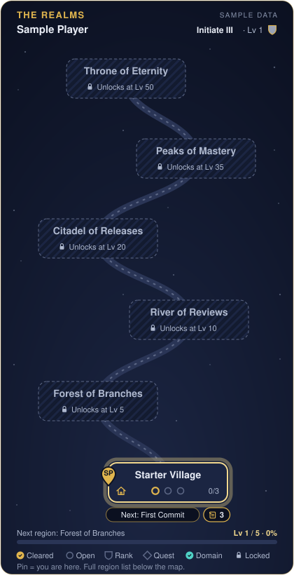

<b>🗺 World map</b>: Starter Village (0/3)

<picture><source media="(prefers-color-scheme: light)" srcset="new-player.light.svg"></picture>

*Sample data.*

**You are here: Starter Village** (0/3) — next: *First Commit*

**Upcoming:** Forest of Branches at Lv 5 · River of Reviews at Lv 10

| Region | Status | Progress |
| --- | --- | --- |
| Starter Village | 📍 Current | 0/3 |
| Forest of Branches | 🔒 Lv 5 | 0/3 |
| River of Reviews | 🔒 Lv 10 | 0/3 (First verified ally not available yet) |
| Citadel of Releases | 🔒 Lv 20 | 0/3 |
| Peaks of Mastery | 🔒 Lv 35 | 0/3 |
| Throne of Eternity | 🔒 Lv 50 | 0/3 |

